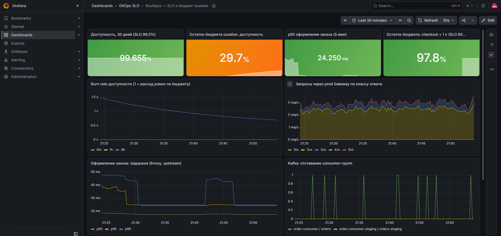

# GitOps с SLO и разбором инцидентов

Перевод микросервисного приложения с ручного деплоя на «как у взрослых»: инфраструктура кодом,
деплой через Git, SLO с бюджетом ошибок, бэкапы с проверкой восстановления, учебные аварии
с постмортемами. English: [README.en.md](README.en.md).

Приложение — чужое: [Online Boutique](https://github.com/GoogleCloudPlatform/microservices-demo)
(11 микросервисов, Apache-2.0) + свой сервис на Kafka. Суть проекта — платформа и эксплуатация.
Код сервисов и CI — в [gitops-slo-app](https://github.com/Sinerror/gitops-slo-app).

## Результаты

<!-- RESULTS:START -->
| Метрика | До (ручной деплой) | После | Как измерено |
| --- | --- | --- | --- |
| Подъём кластера + ArgoCD с нуля | — | **76 с** (образ узла kind уже в кэше Docker) | `terraform apply`, `measurements/raw/tf-apply-2.log` |
| Подъём всего стенда до работающего магазина | — | **702 с** (11 мин 42 с): `terraform apply` 96 с + 606 с до состояния «все 20 приложений ArgoCD Synced/Healthy, магазин отвечает». Образы узлов уже были в кэше Docker, остальные скачивались заново. Первая попытка зависла на тупике в sync-волнах — найден и исправлен | `make up`, `measurements/bootstrap.csv`, логи обоих прогонов в `measurements/raw/` |
| Lead time: коммит → staging (выкачено, smoke-тест пройден) | **≥ 139 с** — только машинное время 7 шагов ручной инструкции, выполненных скриптом без человека (`legacy/auto-baseline.sh`). Без тестов, сканирования, реестра и записи в Git. С человеком не замерялось (`legacy/stopwatch.sh`) | **344 с** — один релиз `sha-0699e29`: CI 86 с, остальное — опрос Git в ArgoCD, выкатка и smoke-тест | `make dora` (`scripts/dora.sh`) |
| Lead time: коммит → prod | — (в ручной схеме отдельного staging не было) | **728 с** — тот же релиз `sha-0699e29`; включает ожидание ручного запуска promote (через ~2 мин после готовности staging) и ~4 мин от коммита promote до конца синка prod | `make dora` |
| p95 главной магазина (найденный инцидент) | 4.02 с | **0.021 с** | [постмортем 00](postmortems/00-dns-metadata-lookup.md) |
| Обнаружение аварий (MTTD) | _по условию задачи: от клиентов (не замер)_ | **111–141 с** в 5 прогонах сценариев 02, 03, 04; Kafka lag (05) — **276 и 685 с**, зависит от потока заказов | `measurements/chaos-results.csv` |
| Восстановление (MTTR) | _по условию задачи: ~1 ч (не замер)_ | **17–304 с** в 6 чистых прогонах из 9. В первых прогонах 03, 04 и 05 — **12.5–21 мин**: каждый раз подвёл наш собственный инструмент восстановления (постмортемы [03](postmortems/03-bad-release.md), [04](postmortems/04-redis-disk-full.md), [05](postmortems/05-kafka-consumer-lag.md)) | `measurements/chaos-results.csv` |
| Восстановление namespace из бэкапа | — | **12 с** restore, **36 с** до работающего магазина, данные корзины на месте | `measurements/backup-restore.csv` |
| Trivy-гейт (HIGH/CRITICAL) | — | исходные образы: 7 + 4 HIGH CVE → exit 1; после обновления Go 1.27.3 и зависимостей → 0 | локальный прогон той же команды, что в CI: `measurements/raw/2026-11-09-trivy.txt` |
<!-- RESULTS:END -->

По голым секундам конвейер **не быстрее** ручной выкатки: 344 с против 139 с машинного времени. За эти
~3.5 минуты он делает то, чего в ручной схеме нет: тесты, Trivy, публикация образа в реестр, коммит в Git
(история и откат через `git revert`) и smoke-тест с оформлением заказа. Сколько времени ручная выкатка
занимает у человека, здесь не измерено.

Все числа — из реальных прогонов на стенде (kind, 4 узла, ноутбук 32 ГБ RAM), сырые данные в
[`measurements/`](measurements/). Нагрузка синтетическая (Locust из апстрима, 10 пользователей).



_Снимок через час после подъёма стенда с нуля: бюджет доступности частично израсходован ошибками 5xx во время развёртывания._

## Архитектура

```
gitops-slo-app ──CI──► test ► build ► Trivy ► GHCR
                 └────► коммит тега в envs/staging ─┐
gitops-slo-platform (этот репозиторий)              │ ArgoCD (app of apps, sync waves)
  terraform/  kind-кластер (или Yandex Managed K8s) + ArgoCD
  argocd/apps Applications платформы и приложения   ▼
  ┌──────────────────────────── Kubernetes 1.36 (kind: 1 control-plane + 3 worker) ──────────┐
  │ Envoy Gateway (Gateway API) · cert-manager · CoreDNS-конфиг                               │
  │ boutique-staging / boutique-prod: свой Helm-чарт, NetworkPolicy, PDB, smoke-тест PostSync │
  │ Kafka (Strimzi, KRaft) ◄── checkoutservice ──► order-consumer                             │
  │ Prometheus · Alertmanager · Grafana · Loki + Alloy  (SLO, burn rate, runbooks)             │
  │ OpenBao + External Secrets · Velero + SeaweedFS (S3)                                       │
  └────────────────────────────────────────────────────────────────────────────────────────────┘
```

| Задача | Чем решено | Почему так |
| --- | --- | --- |
| Инфраструктура кодом | Terraform: модули `kind-cluster`, `argocd-bootstrap`; окружения `local` и `yandex` | Один модуль bootstrap для локального и облачного кластера |
| Деплой | ArgoCD app of apps, sync waves, selfHeal; свой Helm-чарт `charts/boutique` с values по окружениям | Всё состояние — в Git, откат = `git revert` |
| Входящий трафик | Gateway API + Envoy Gateway, отдельный Gateway на окружение, TLS от cert-manager | ingress-nginx в архиве с марта 2026 |
| SLO | SLI с Envoy (как видит клиент), multi-window multi-burn-rate алерты | Алерт по бюджету, а не по каждому всплеску |
| Логи | Loki + Grafana Alloy | Promtail EOL с марта 2026 |
| Очередь | Kafka (Strimzi 1.3, KRaft), алерт на consumer lag | Асинхронная обработка заказов |
| Секреты | OpenBao + External Secrets Operator, Kubernetes auth | Форк Vault (MPL-2.0); ресурсы HashiCorp недоступны из сети стенда |
| Бэкапы | Velero + Kopia (файловый бэкап томов), S3 на SeaweedFS, ежедневное расписание | Снапшоты local-path невозможны; MinIO не публикует образы |
| Безопасность | NetworkPolicy default-deny, RBAC (developers — только чтение, on-call — аварийные действия в prod, секреты не видят), non-root, read-only rootfs, Trivy-гейт, Actions по SHA | Изменения в прод — только через Git |

## SLO

| SLO | Цель | SLI | Бюджет за 30 дней |
| --- | --- | --- | --- |
| Доступность магазина | 99.5% | доля не-5xx на prod Gateway | 0.5% запросов |
| Скорость оформления заказа | 95% быстрее 1 с | `POST /cart/checkout`, гистограмма Envoy | 5% запросов |

Правила: [`platform/monitoring/manifests/slo-rules.yaml`](platform/monitoring/manifests/slo-rules.yaml).
Burn-rate алерты защищают бюджет; для быстрого обнаружения явных аварий есть симптомные алерты
(`BoutiqueHighErrorRate`, `CheckoutErrorRateHigh`) и алерты на причины (узел, Redis, Kafka lag, OpenBao).
У каждого алерта ссылка на [runbook](docs/runbooks/).

## Учебные аварии

<!-- CHAOS:START -->
| # | Сценарий | Первый алерт | MTTD | MTTR | 5xx пользователям* | Постмортем |
| --- | --- | --- | --- | --- | --- | --- |
| 00 | Реальный: DNS-запрос в горячем пути frontend | вручную | — | — | таймауты, p95 4 с | [00](postmortems/00-dns-metadata-lookup.md) |
| 01 | Падение всех подов frontend | нет (в пределах бюджета) | — | 21 с | ≈19 | [01](postmortems/01-pod-kill.md) |
| 01 | …повтор после retry + outlier detection в Envoy | нет | — | 17 с | ≈11 | [01](postmortems/01-pod-kill.md) |
| 02 | Падение worker-узла | `NodeNotReady` | 141 с | 155 с | ≈78 | [02](postmortems/02-node-down.md) |
| 03 | Плохой релиз (50% ошибок checkout), прогон 1 | `CheckoutErrorRateHigh` | 111 с | 755 с — `git push` отката упал на DNS, скрипт не заметил | ≈34 | [03](postmortems/03-bad-release.md) |
| 03 | …прогон 2 (публикация с повторами) | `CheckoutErrorRateHigh` | 127 с | 145 с | ≈15 | [03](postmortems/03-bad-release.md) |
| 04 | Заполнен диск БД корзин (Redis), прогон 1 | `RedisAOFWriteFailing` | 141 с | ~15.5 мин — исправление молча не сработало | ≈304 | [04](postmortems/04-redis-disk-full.md) |
| 04 | …прогон 2 (инструмент исправлен) | `RedisAOFWriteFailing` | 130 с | 131 с | ≈18 | [04](postmortems/04-redis-disk-full.md) |
| 05 | Отставание consumer Kafka, прогон 1 | `KafkaConsumerLagHigh` | 685 с | 1285 с — скрипт не увидел сработавший алерт | ≈20 | [05](postmortems/05-kafka-consumer-lag.md) |
| 05 | …прогон 2 (инструмент исправлен) | `KafkaConsumerLagHigh` | 276 с | 304 с | ≈5 | [05](postmortems/05-kafka-consumer-lag.md) |
<!-- CHAOS:END -->

\* `sum(increase(envoy_http_downstream_rq_xx{code_class="5"}[окно]))` — оценка Prometheus, по одному прогону на строку.
Сценарии 03 и 05 выкатывают «плохую» конфигурацию коммитом в этот репозиторий и откатывают `git revert` —
эти коммиты видны в истории `main`. MTTD у них отсчитывается от коммита, то есть включает доставку релиза.

MTTD — от внесения аварии до алерта в Alertmanager; MTTR — до восстановления. Скрипты: [`chaos/`](chaos/).

## Запуск

Нужно: Docker (≥ 16 ГБ памяти для VM), kind, terraform, kubectl, helm, bash, make. На Windows команды запускаются из Git Bash (в PowerShell `bash` указывает на WSL).

```bash
make up            # terraform apply + ожидание ArgoCD + init OpenBao; печатает адреса
make status        # приложения ArgoCD
make chaos-01      # учебная авария
make backup-test   # бэкап -> удаление namespace -> восстановление -> проверка данных
make destroy       # удалить всё
```

| Что | Адрес |
| --- | --- |
| Магазин prod / staging | http://shop.localtest.me:18080 · http://staging.localtest.me:18081 |
| ArgoCD / Grafana | http://argocd.localtest.me:18090 · http://grafana.localtest.me:18090 (`make grafana-password`) |
| Prometheus / Alertmanager / OpenBao | http://prometheus.localtest.me:18090 · http://alertmanager.localtest.me:18090 · http://openbao.localtest.me:18090 |

`*.localtest.me` резолвится в 127.0.0.1, порты слушают только localhost.
`registry.terraform.io` из РФ/РК недоступен — `make up` ставит провайдеры через зеркало Yandex Cloud
(`terraform/terraformrc.mirror`, отключается `TF_MIRROR=0`).

Облачный вариант: [`terraform/envs/yandex`](terraform/envs/yandex/main.tf) — Managed Kubernetes,
remote state в Object Storage. Код проходит `terraform validate`, но в рамках проекта в облаке
не применялся (стоимость); для работы в облаке Gateway нужно перевести с NodePort на LoadBalancer.

## Структура

```
terraform/       модули и окружения (local = kind, yandex = Managed Kubernetes)
platform/rbac/   роли для людей: developers / on-call
argocd/apps/     Applications: платформа (волны 0–1), приложение (волна 2)
platform/        values и манифесты компонентов платформы
charts/boutique/ свой Helm-чарт приложения
envs/            values окружений (теги образов пишет CI)
chaos/           учебные аварии с замером MTTD/MTTR
postmortems/     разборы аварий
docs/runbooks/   runbook'и, на которые ссылаются алерты
legacy/          «как было»: ручной деплой с секундомером (базовая линия DORA)
measurements/    сырые результаты замеров
hack/            отладка GitOps до публикации репозитория
```

## Ограничения

- Приложение демонстрационное, нагрузка синтетическая; один брокер Kafka, один инстанс OpenBao
  с ручным unseal — компромиссы учебного стенда, в README компонентов указано, что было бы в проде.
- Сервисы с одной репликой (ad, email, payment, shipping, recommendation, redis) — единые точки отказа.
- Redis корзин на tmpfs фиксированного размера: так сценарий «диск заполнен» воспроизводим в kind,
  а сохранность данных обеспечивает бэкап Velero.
